<p>
  
</p>

<p><b>English</b> · <a href="README.pl.md">Polski</a></p>

<p>
  
  
  
</p>

**Desktop app that turns text into a narrated video with AI-generated images.**
Images come from OpenAI (`dall-e-3`), timing from AssemblyAI, narration from TikTok Voice TTS. Example videos: [YouTube playlist](https://www.youtube.com/playlist?list=PLlVNFvFbjZ3G73D6XfwyN_exaYW9FQOk6).

[Report an issue](../../issues)

<p align="center"></p>

## Features

- **Narrator language** chosen to match the text.
- **Chapters**: text split by length; one generated image per chapter.
- **Image sizes** for `dall-e-3`: `1024x1024`, `1792x1024` or `1024x1792`.

## Quick start

Requirements: Python 3, internet access, OpenAI and AssemblyAI API keys.

```bash
git clone https://github.com/vviktooor/clipCraft.git
cd clipCraft
pip3 install -r requirements.txt
cd build
python3 gui.py
```

## Usage

In the window set: narrator language, video output directory, image size, chapter length (e.g. `100` = 100 characters per chapter) and both API keys. API keys are typed in the app and are not saved to files. Known issue: the app prints them to the console (`gui.py`, line 69), so do not share console logs.

## Languages

This README is available in English (default) and [Polish](README.pl.md). Interface: English. Polish interface: planned (WR standard v4.4).

## Repository layout

| Where | What |
|---|---|
| `build/` | Application source (`gui.py` is the entry point) |
| `Screenshots/` | Screenshots |
| `requirements.txt` | Python dependencies |

## Tests and quality

| Check | Result | Date |
|---|---|---|
| Tests | NOT VERIFIED (no tests yet) | 2026-11-25 |

## Credits

[@oscie57](https://github.com/oscie57): [TikTok Voice TTS](https://github.com/oscie57/tiktok-voice).

## License

No licence file: all rights reserved. Ask before reusing the code.
Author: WR

---

<p align="center"><sub><b>WR</b> · <a href="https://github.com/vviktooor">vviktooor</a></sub></p>
