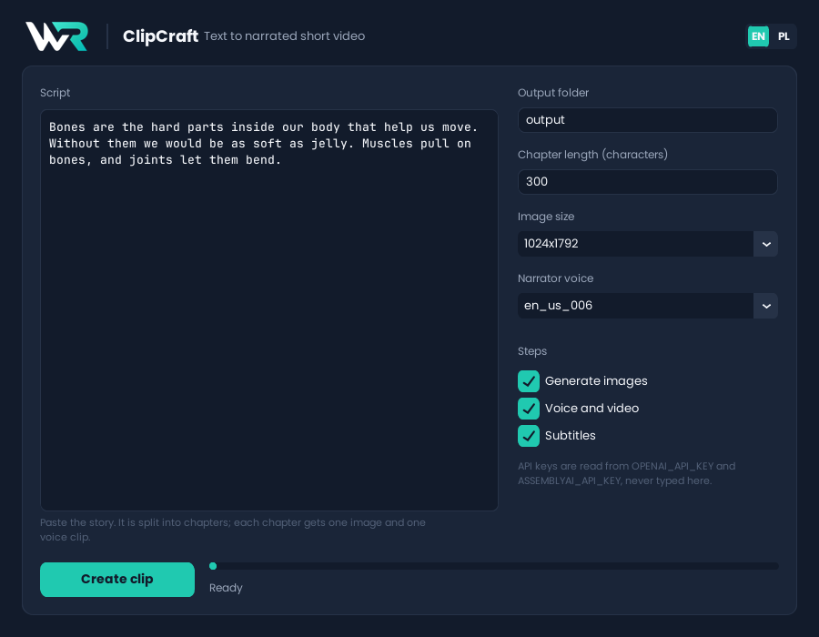

<p>
  
</p>

<p>&nbsp;<a href="README.pl.md"></a></p>

<p>
  
  
  <a href="../../actions/workflows/ci.yml"></a>
  
</p>

**Desktop app that turns text into a narrated video with AI-generated images.**
Images come from OpenAI (`dall-e-3`), narration from TikTok Voice TTS, subtitles from AssemblyAI. Example videos: [YouTube playlist](https://www.youtube.com/playlist?list=PLlVNFvFbjZ3G73D6XfwyN_exaYW9FQOk6).

<p align="center"></p>

## Features

- **Chapters**: the script is split on whole sentences up to a set length; one image and one voice clip per chapter.
- **Pick the steps**: images, voice and video, subtitles; each can be switched off.
- **Image sizes** for `dall-e-3`: `1024x1792`, `1024x1024` or `1792x1024`.
- **Safe keys**: API keys come from environment variables, are never typed into the window and never printed.
- **English and Polish** interface, WR look (logo, ink and signal colours, Poppins), errors shown in the window.

## Quick start

Requirements: Python 3.10+ with Tkinter, ImageMagick (for subtitles), OpenAI and AssemblyAI keys.

```bash
git clone https://github.com/vviktooor/clipCraft.git
cd clipCraft
pip3 install -r requirements.txt
export OPENAI_API_KEY=... ASSEMBLYAI_API_KEY=...
python3 -m clipcraft
```

## Configuration

Variables (see `.env.example`): `OPENAI_API_KEY`, `ASSEMBLYAI_API_KEY`, `IMAGEMAGICK_BINARY` (path to `magick`; found on `PATH` when empty), `SUBTITLE_FONT`, `APP_LANG` (`en` or `pl`).

## Example output

A frame from a generated clip with burned-in subtitles:

<p align="center"></p>

## Usage

Paste the script, choose output folder, chapter length, image size and narrator voice, tick the steps and press **Create clip**. Results land in the output folder: `images/`, `voices/`, `complete_clip.mp4` and the subtitled copy.

## Languages

This README is available in English (default) and [Polish](README.pl.md). Interface: English by default, Polish via the EN/PL switch or `APP_LANG=pl` (strings in `clipcraft/locales/`).

## Repository layout

| Where | What |
|---|---|
| `clipcraft/gui.py` | CustomTkinter window |
| `clipcraft/pipeline.py` | Images, voices, video and subtitles steps |
| `clipcraft/chapters.py` | Script splitting |
| `clipcraft/config.py` | Settings from environment variables |
| `clipcraft/tiktokvoice.py` | TikTok TTS client (third-party, adapted) |
| `clipcraft/locales/` | `en.json` and `pl.json` |
| `tests/` | Unit tests |
| `docs/screenshots/` | Screenshots from the running app |

## Tests and quality

```bash
ruff check .
ruff format --check .
python3 -m unittest discover -s tests
```

| Check | Result | Date |
|---|---|---|
| ruff | PASS | 2026-11-25 |
| Tests | PASS (9/9) | 2026-11-25 |
| Screenshots | PASS (real app under Xvfb, EN and PL) | 2026-11-25 |
| Full generation | NOT VERIFIED (needs paid OpenAI and AssemblyAI keys) | 2026-11-25 |

## Credits

[@oscie57](https://github.com/oscie57): [TikTok Voice TTS](https://github.com/oscie57/tiktok-voice).

## License

No licence file: all rights reserved. Ask before reusing the code. Author: WR.

Found a bug or have an idea? [Open an issue](../../issues).
