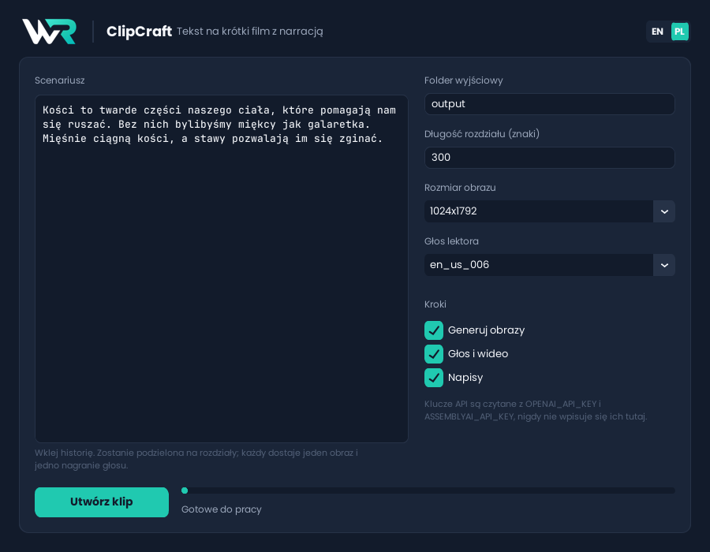

<p>
  
</p>

<p><a href="README.md"></a>&nbsp;</p>

<p>
  
  
  <a href="../../actions/workflows/ci.yml"></a>
  
</p>

**Aplikacja desktopowa, która z tekstu robi film z lektorem i obrazami generowanymi przez AI.**
Obrazy z OpenAI (`dall-e-3`), lektor z TikTok Voice TTS, napisy z AssemblyAI. Przykładowe filmy: [playlista YouTube](https://www.youtube.com/playlist?list=PLlVNFvFbjZ3G73D6XfwyN_exaYW9FQOk6).

<p align="center"></p>

## Funkcje

- **Rozdziały**: scenariusz dzielony na całe zdania do zadanej długości; jeden obraz i jedno nagranie na rozdział.
- **Wybór kroków**: obrazy, głos i wideo, napisy; każdy można wyłączyć.
- **Rozmiary obrazów** dla `dall-e-3`: `1024x1792`, `1024x1024` albo `1792x1024`.
- **Bezpieczne klucze**: klucze API z zmiennych środowiskowych, nie wpisuje się ich w oknie i nie są wypisywane.
- **Interfejs po angielsku i po polsku**, wygląd WR (logo, kolory ink i signal, Poppins), błędy widoczne w oknie.

## Szybki start

Wymagania: Python 3.10+ z Tkinterem, ImageMagick (do napisów), klucze OpenAI i AssemblyAI.

```bash
git clone https://github.com/vviktooor/clipCraft.git
cd clipCraft
pip3 install -r requirements.txt
export OPENAI_API_KEY=... ASSEMBLYAI_API_KEY=...
APP_LANG=pl python3 -m clipcraft
```

## Konfiguracja

Zmienne (zobacz `.env.example`): `OPENAI_API_KEY`, `ASSEMBLYAI_API_KEY`, `IMAGEMAGICK_BINARY` (ścieżka do `magick`; gdy puste, szukany w `PATH`), `SUBTITLE_FONT`, `APP_LANG` (`en` lub `pl`).

## Przykładowy wynik

Klatka z wygenerowanego klipu z wypalonymi napisami:

<p align="center"></p>

## Użycie

Wklej scenariusz, wybierz folder wyjściowy, długość rozdziału, rozmiar obrazu i głos lektora, zaznacz kroki i kliknij **Utwórz klip**. Wyniki trafiają do folderu wyjściowego: `images/`, `voices/`, `complete_clip.mp4` i kopia z napisami.

## Języki

Ten README jest po polsku i po [angielsku](README.md) (wersja domyślna). Interfejs: domyślnie angielski, polski przez przełącznik EN/PL lub `APP_LANG=pl` (teksty w `clipcraft/locales/`).

## Struktura repozytorium

| Gdzie | Co |
|---|---|
| `clipcraft/gui.py` | Okno CustomTkinter |
| `clipcraft/pipeline.py` | Kroki: obrazy, głosy, wideo i napisy |
| `clipcraft/chapters.py` | Dzielenie scenariusza |
| `clipcraft/config.py` | Ustawienia ze zmiennych środowiskowych |
| `clipcraft/tiktokvoice.py` | Klient TikTok TTS (zewnętrzny, dostosowany) |
| `clipcraft/locales/` | `en.json` i `pl.json` |
| `tests/` | Testy jednostkowe |
| `docs/screenshots/` | Zrzuty z uruchomionej aplikacji |

## Testy i jakość

```bash
ruff check .
ruff format --check .
python3 -m unittest discover -s tests
```

| Kontrola | Wynik | Data |
|---|---|---|
| ruff | PASS | 2026-11-25 |
| Testy | PASS (9/9) | 2026-11-25 |
| Zrzuty ekranu | PASS (prawdziwa aplikacja pod Xvfb, EN i PL) | 2026-11-25 |
| Pełne generowanie | NOT VERIFIED (wymaga płatnych kluczy OpenAI i AssemblyAI) | 2026-11-25 |

## Podziękowania

[@oscie57](https://github.com/oscie57): [TikTok Voice TTS](https://github.com/oscie57/tiktok-voice).

## Licencja

Brak pliku licencji: wszelkie prawa zastrzeżone. Zapytaj przed ponownym użyciem kodu. Autor: WR.

Znalazłeś błąd albo masz pomysł? [Zgłoś go w Issues](../../issues).
